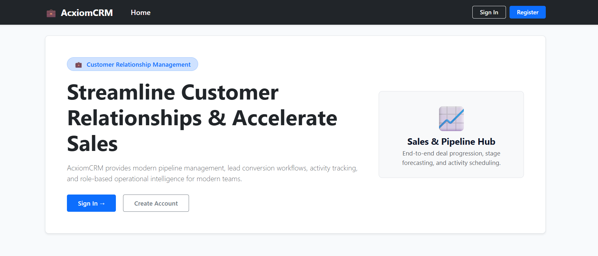
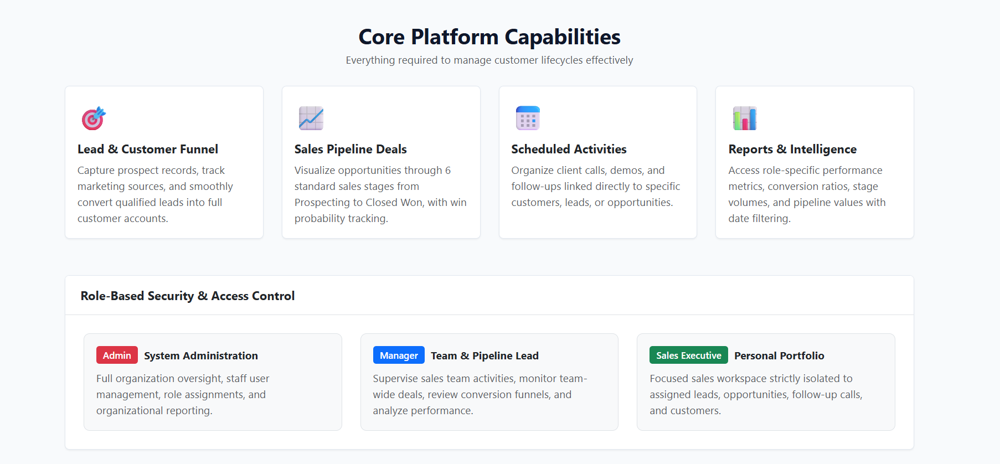
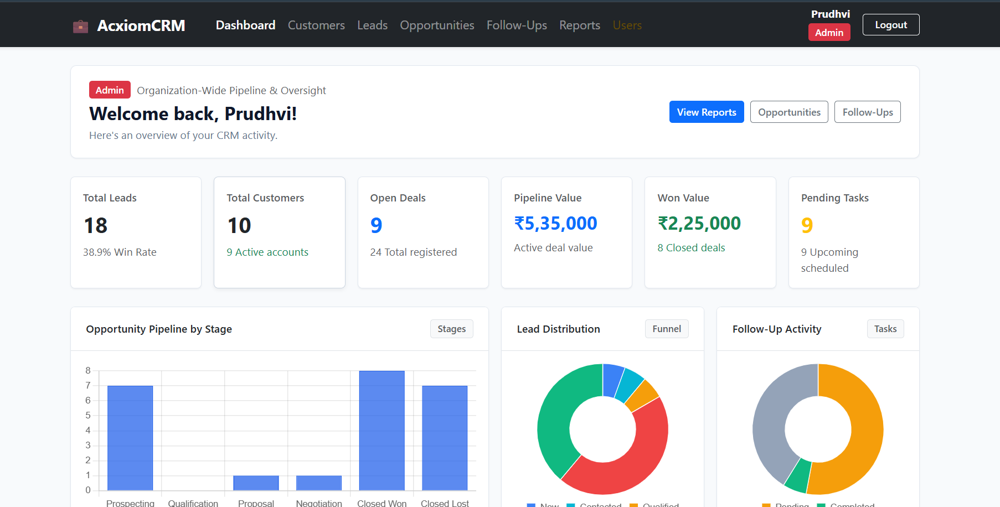
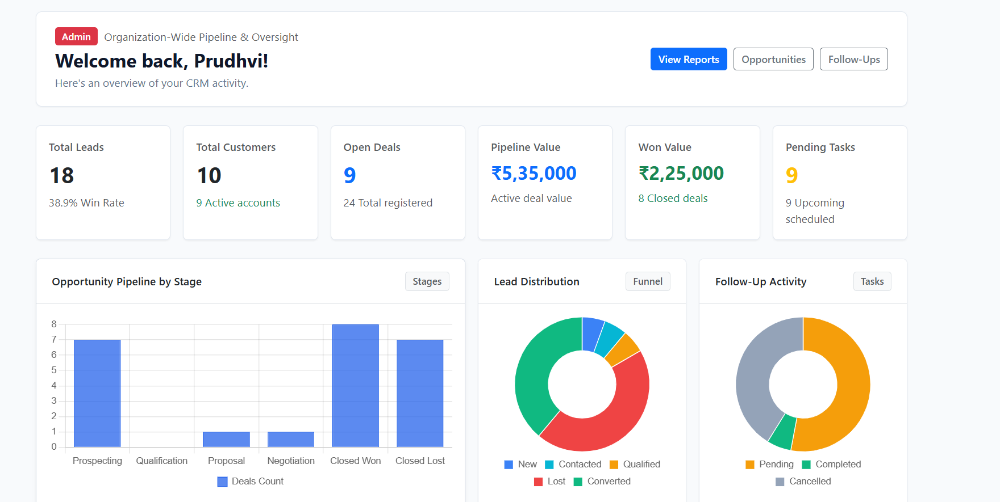
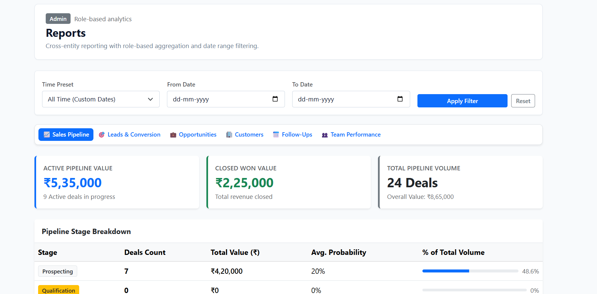
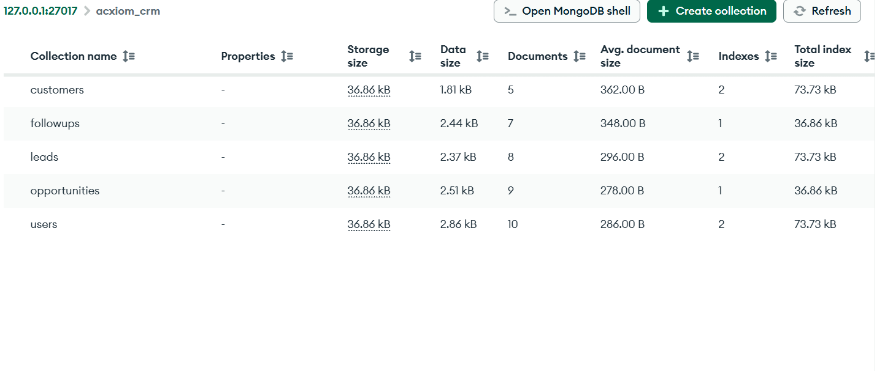
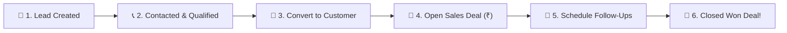

# 💼 AcxiomCRM

> A simple, easy-to-understand **MERN Stack** (MongoDB, Express, React, Node.js) Customer Relationship Management web application built for college assignments and technical interviews.

---

## 📌 What is AcxiomCRM?

In simple terms, **AcxiomCRM** is a web tool used by sales teams to turn strangers into paying customers and keep track of daily business activities.

Think of it as a digital notebook and pipeline for a company's sales team:
1. **Catch a Lead** (someone interested in your product, e.g., from LinkedIn or your website).
2. **Convert the Lead** into an official **Customer** with 1 click once they are qualified.
3. **Create a Sales Deal (Opportunity)** to track the deal value in Rupees (₹) and the probability of winning it.
4. **Schedule Follow-Ups** (phone calls, meetings, or emails) so the sales rep never forgets an appointment.
5. **View Dashboard & Reports** to see real-time charts showing total revenue won, active deals, and team performance.

---

## 📸 Screenshots & Visual Tour

### 1. Welcome & Landing Page
A clean, welcoming homepage introducing the platform with quick links to sign in or register.


---

### 2. Role-Based Permissions & Capabilities
Three distinct roles designed to keep company data safe and organized:
- **Admin**: Has full power over the system and manages employee accounts.
- **Manager**: Oversees the entire sales team, monitors deals, and reads reports.
- **Sales Executive**: Focused purely on their own assigned leads, customers, and calls.


---

### 3. Live Dashboard & Interactive Charts
As soon as you log in, you see your key numbers (Total Leads, Customers, Active Pipeline, Won Revenue) and Chart.js graphs showing deal stages.


---

### 4. Visual KPI Analytics
Track your sales funnel distribution and follow-up completion status at a glance.


---

### 5. Multi-Tab Reports with Date Filters
Filter data by preset dates (**Today**, **This Week**, **This Month**) or custom dates to see pipeline health, conversion rates, and sales rep performance.


---

### 6. MongoDB Database Structure
Clean, standard MongoDB collections stored locally or in the cloud.


---

## 🔄 The Complete Sales Workflow (How It Works)



1. **Lead Qualification**: A new lead is added (e.g. "Sunil Verma from Acme Corp").
2. **1-Click Conversion**: Click the **Convert** button. The system automatically creates a new Customer account, marks the lead as `Converted`, and prevents duplicate conversions.
3. **Opportunity Pipeline**: Create a deal for that customer (e.g., "Cloud Upgrade - ₹1,50,000"). When you advance the stage to `Closed Won`, the win probability automatically jumps to **100%**.
4. **Follow-Up Scheduling**: Schedule a Meeting or Call. The activity links directly to the customer and deal.
5. **Dashboard Updates**: All metrics update instantly on the Dashboard and Reports page.

---

## 👥 The 3 User Roles (Who Can Do What?)

| Feature | Admin | Manager | Sales Executive |
|---|:---:|:---:|:---:|
| **Sign Up** | Via Admin Panel | Via Admin Panel | Public Sign-Up (`/register`) |
| **User Management** | ✅ Full Control | ❌ No Access | ❌ No Access |
| **Activate / Deactivate Users** | ✅ Yes | ❌ No Access | ❌ No Access |
| **Customers & Leads** | View & Edit All | View & Edit All | Only View Assigned To Me |
| **Convert Leads** | ✅ Yes | ✅ Yes | ✅ Yes (Assigned only) |
| **Delete Records** | ✅ Yes | ✅ Yes | ❌ Forbidden |
| **Deals & Follow-Ups** | View & Edit All | View & Edit All | Only View Assigned To Me |
| **Team Performance Reports** | ✅ Yes | ✅ Yes | ❌ Forbidden |

---

## ⚡ Quick Start Guide (Run Locally in 3 Steps)

### Prerequisites
- [Node.js](https://nodejs.org/) (v18 or v20+)
- [MongoDB Community Server](https://www.mongodb.com/try/download/community) installed and running locally on port 27017

---

### Step 1: Start the Backend Server
Open a terminal:
```bash
cd server

# 1. Create your environment file
cp .env.example .env

# 2. Install dependencies
npm install

# 3. Seed demo data (users, customers, leads, deals)
npm run seed

# 4. Start the server
npm run dev
```
> Server will start at: **`http://localhost:5000`**  
> Check health status: Visit `http://localhost:5000/api/health` in your browser.

---

### Step 2: Start the React Frontend
Open a **second terminal**:
```bash
cd client

# 1. Create your environment file
cp .env.example .env

# 2. Install dependencies
npm install

# 3. Start the Vite dev server
npm run dev
```
> Frontend will open at: **`http://localhost:5173`**

---

### Step 3: Log In with Demo Credentials

| Role | Email | Password | What You Can Test |
|---|---|---|---|
| **Admin** | `admin@acxiom.com` | `Admin@123` | User management, activate/deactivate users, all CRM data |
| **Manager** | `manager@acxiom.com` | `Manager@123` | Team pipeline, reassigning leads/customers, reports |
| **Sales Executive** | `sales@acxiom.com` | `Sales@123` | Personal assigned leads, converting leads, closing deals |

---

## 🧱 Technology Stack Explained Simply

- **React 18 + Vite**: Builds a fast Single-Page Application (SPA) where pages load instantly without refreshing the browser.
- **Bootstrap 5.3 + Vanilla CSS**: Gives clean, responsive cards, buttons, modals, and tables that work on mobile and desktop.
- **Chart.js**: Generates the interactive bar and doughnut charts on the dashboard.
- **Axios**: Sends HTTP requests to the backend with automatic JWT Bearer token attachment.
- **Node.js + Express**: Handles API routes, business logic, and security rules.
- **MongoDB + Mongoose**: Stores data in readable JSON-like documents with built-in schema validation.
- **bcryptjs**: Hashes user passwords with cryptographic salts so plaintext passwords are never stored.
- **JWT (JSON Web Token)**: Secures all private API endpoints using stateless token authentication.

---

## 🧪 Automated Testing

The project includes **142 automated tests** that verify login, security checks, role permissions, lead conversion, and pipeline math.

To run all tests:
```bash
cd server
npm test
```

### Test Suite Summary:
- ✅ **Phase 2 (Auth & RBAC)**: 22 tests passing
- ✅ **Phase 3 (Customers & Leads)**: 25 tests passing
- ✅ **Phase 4 (Opportunities & Follow-Ups)**: 27 tests passing
- ✅ **Phase 5 (Dashboard & Reports)**: 25 tests passing
- ✅ **Registration Flow**: 14 tests passing
- ✅ **End-to-End Business Lifecycle**: 29 tests passing
- **Total: 142 Passed, 0 Failed (100% Pass Rate)**

To build the frontend for production:
```bash
cd client
npm run build
```
Bundle size is under 500 kB with 0 errors.

---

## 🎓 Viva & Technical Interview Talking Points

Here are answers to the top questions examiners ask about this project:

1. **How is security handled?**
   - Passwords are never saved in plaintext. They are encrypted using `bcryptjs` with 10 salt rounds before saving to MongoDB.
   - When users log in, the backend signs a JSON Web Token (JWT) that lasts 7 days.
   - Brute-force protection: If someone types the wrong password 5 times, the account is temporarily locked for 15 minutes.

2. **How does Role-Based Access Control (RBAC) work?**
   - Security is not just hiding buttons in React! True security is checked on the server in database queries:
     ```javascript
     if (req.user.role === 'Sales Executive') {
       query.assignedTo = req.user._id;
     }
     ```
   - A Sales Executive cannot see or edit someone else's customer even if they try to bypass the UI using Postman or curl.

3. **What is the Unified Modal Pattern?**
   - Instead of writing two separate HTML forms for "Add Customer" and "Edit Customer" (which causes 300+ lines of duplicated code), we use a single modal. If an existing record is selected, it pre-fills the data and runs `PUT`; otherwise, it starts blank and runs `POST`. This makes the code shorter, cleaner, and much easier to debug.

4. **What happens during Lead Conversion?**
   - An atomic workflow takes the lead's name, email, phone, and company, creates a new `Customer` record, marks the lead as `Converted`, and saves the new customer's ID into `lead.convertedCustomer` so it can never be converted twice.

---

## 📂 Project Directory Overview

```text
AcxiomCRM/
├── images/               # Screenshots used in this README
├── client/               # React Frontend (Vite)
│   ├── src/
│   │   ├── components/   # Navbar, Footer, Layout, ProtectedRoute
│   │   ├── context/      # AuthContext (stores logged-in user & token)
│   │   ├── pages/        # Dashboard, Customers, Leads, Deals, Reports, Users
│   │   ├── services/     # api.js (Axios helper for all API calls)
│   │   ├── App.jsx       # Route definitions
│   │   ├── index.css     # Clean Bootstrap styling tokens
│   │   └── main.jsx      # React root
│   └── package.json
│
├── server/               # Express Backend API
│   ├── config/           # MongoDB database connection (db.js)
│   ├── controllers/      # Functions handling API logic (Customers, Leads, Deals, etc.)
│   ├── middleware/       # JWT verification & role authorization checks
│   ├── models/           # Mongoose Schemas (User, Customer, Lead, Opportunity, FollowUp)
│   ├── routes/           # REST API endpoints mounted to Express
│   ├── scripts/          # Seed script & 142 automated tests
│   ├── utils/            # JWT helpers, date filter, audit logger
│   └── server.js         # Entry point starting port 5000
│
└── README.md             # This guide
```

---

## 📄 License & Academic Note

Developed as a college assignment project for **B.Tech CSE**. Built strictly for educational and demonstration purposes.